<a id="topo"></a>

# UFFA STORE

## Manual do Site

**Da descoberta à autenticidade — tudo o que o site faz, ecrã a ecrã.**

Manual funcional e operacional da loja online UFFA Store. Segue a mesma estrutura, identidade e numeração da apresentação `docs/apresentacao-site-uffa.pptx`: doze capítulos e quatro anexos.

| Item | Detalhe |
| --- | --- |
| Versão | 2.0 · novembro de 2026 |
| Âmbito | Site público, checkout, portal de encomendas, verificação de autenticidade e painel de operações |
| Produção | `https://uffastore.pt` |
| Desenvolvimento | `http://localhost:8080` |
| Idiomas | Português, Inglês e Espanhol |
| Temas | Claro e escuro |
| Stack | React 19 · TanStack Start · Tailwind CSS · Shopify Storefront API |
| Documento irmão | `docs/apresentacao-site-uffa.pptx` (14 slides) |

> **Como usar este manual.** Cada capítulo abre com o número e o título que aparecem no PowerPoint. As figuras usam capturas reais do site. Os blocos **Nota**, **Dica**, **Demo** e **Atenção** marcam contexto técnico, boas práticas, dados de demonstração e riscos. No fim de cada capítulo há uma **checklist de demonstração** para ensaiar a apresentação.

---

<a id="indice"></a>

## Índice

| # | Capítulo | O que cobre |
| --- | --- | --- |
| [01](#cap-01) | Posicionamento | Promessa da marca, jornada, públicos e mapa de rotas |
| [02](#cap-02) | Home | Cabeçalho, hero, confiança, categorias, destaques, portal e newsletter |
| [03](#cap-03) | Catálogo | Filtros, URL, cartões, preços, PROMO e stock |
| [04](#cap-04) | Produto | Galeria, tamanhos, preço, garantias e relacionados |
| [05](#cap-05) | Carrinho | Camada lateral, quantidades, cupões, partilha e persistência |
| [06](#cap-06) | Checkout | Portes, pagamento, redirecionamento Shopify e erros |
| [07](#cap-07) | Confirmação | Número, código exclusivo, rastreio e autenticidade |
| [08](#cap-08) | Portal | Acesso por três fatores, dashboard, estados e confirmação |
| [09](#cap-09) | Autenticidade | Verificação pública, resultado válido, inválido e privacidade |
| [10](#cap-10) | Operações | Chave, indicadores, fila, editor, avanço e reposição |
| [11](#cap-11) | Mobile | Breakpoints, menu, grelhas, toque e desempenho |
| [12](#cap-12) | Tecnologia | Stack, ficheiros, variáveis, build, deploy e segurança |
| [A](#ap-a) | Anexo A | Dados de demonstração |
| [B](#ap-b) | Anexo B | Resolução de problemas |
| [C](#ap-c) | Anexo C | Comandos, build e deploy |
| [D](#ap-d) | Anexo D | Mapa de ficheiros e glossário |

### Índice detalhado

| Secção | Título |
| --- | --- |
| [1.1](#cap-01-1) | A promessa |
| [1.2](#cap-01-2) | A jornada |
| [1.3](#cap-01-3) | Públicos |
| [1.4](#cap-01-4) | Mapa de rotas |
| [2.1](#cap-02-1) | Cabeçalho e navegação |
| [2.2](#cap-02-2) | Hero e faixa de confiança |
| [2.3](#cap-02-3) | Categorias e destaques |
| [2.4](#cap-02-4) | Bloco do portal e newsletter |
| [2.5](#cap-02-5) | Temas e idiomas |
| [3.1](#cap-03-1) | Filtros e pesquisa |
| [3.2](#cap-03-2) | Sincronização com o cabeçalho |
| [3.3](#cap-03-3) | Cartões de produto |
| [3.4](#cap-03-4) | Preços e PROMO |
| [3.5](#cap-03-5) | Stock e estados |
| [4.1](#cap-04-1) | Galeria e informação |
| [4.2](#cap-04-2) | Tamanhos e stock |
| [4.3](#cap-04-3) | Garantias e relacionados |
| [5.1](#cap-05-1) | Artigos e quantidades |
| [5.2](#cap-05-2) | Cupões |
| [5.3](#cap-05-3) | Partilha e persistência |
| [6.1](#cap-06-1) | Entrega e portes |
| [6.2](#cap-06-2) | Pagamento e Shopify |
| [6.3](#cap-06-3) | Cupões e erros |
| [7.1](#cap-07-1) | O que o cliente recebe |
| [7.2](#cap-07-2) | Âmbito da demonstração |
| [8.1](#cap-08-1) | Acesso por três fatores |
| [8.2](#cap-08-2) | Dashboard do cliente |
| [8.3](#cap-08-3) | Fluxos de estado |
| [9.1](#cap-09-1) | Como verificar |
| [9.2](#cap-09-2) | Resultado válido |
| [9.3](#cap-09-3) | Resultado inválido e privacidade |
| [10.1](#cap-10-1) | Entrada e indicadores |
| [10.2](#cap-10-2) | Fila e pesquisa |
| [10.3](#cap-10-3) | Editor e avanço de estado |
| [10.4](#cap-10-4) | Credenciais, histórico e reposição |
| [11.1](#cap-11-1) | Breakpoints e menu |
| [11.2](#cap-11-2) | Ecrãs pequenos |
| [12.1](#cap-12-1) | Stack e ficheiros |
| [12.2](#cap-12-2) | Variáveis de ambiente |
| [12.3](#cap-12-3) | Build, deploy e segurança |

---

<a id="cap-01"></a>

## 01 / POSICIONAMENTO

### Uma loja, não um catálogo.

O site existe para responder a três perguntas antes que o cliente as faça: *é original? serve-me? e depois da compra?* Cada ecrã responde a uma delas.

<a id="cap-01-1"></a>

### 1.1 A promessa

- **Descoberta rápida** — catálogo filtrável, stock visível e preço sem ambiguidade.
- **Compra curta** — carrinho lateral, checkout em três decisões e pagamento no ambiente seguro da Shopify.
- **Pós-compra verificável** — portal privado por encomenda e código de autenticidade por par.

> **Nota.** O site não é um folheto. É a operação da marca: catálogo, encomenda, acompanhamento e prova de autenticidade no mesmo domínio.

<a id="cap-01-2"></a>

### 1.2 A jornada

```text
Home → Catálogo → Produto → Carrinho → Checkout → Confirmação
                                                ↓
                              Portal de rastreio → Autenticidade
                                                ↓
                                        Painel de operações
```

| Momento | Pergunta do cliente | Resposta do site |
| --- | --- | --- |
| Descoberta | “O que têm?” | Home, categorias e catálogo filtrável |
| Decisão | “Serve-me? É original?” | Página de produto, stock por tamanho, selo Verificado |
| Compra | “Como pago?” | Checkout com entrega e pagamento Shopify |
| Pós-compra | “Onde está o meu par?” | Portal com estado, timeline e confirmação |
| Confiança | “É mesmo UFFA?” | Verificação pública `UFFA-AUTH` |

<a id="cap-01-3"></a>

### 1.3 Públicos

| Público | O que precisa | Onde encontra |
| --- | --- | --- |
| Cliente final | Escolher, comprar e acompanhar | Site público, checkout, portal |
| Equipa de operações | Atualizar estados e comunicar | `/operacoes` |
| Marketing | Mostrar produto, preço e prova | Home, catálogo, autenticidade |
| Parceiros | Perceber o modelo | Apresentação e este manual |

<a id="cap-01-4"></a>

### 1.4 Mapa de rotas

| Área | Rota | Acesso |
| --- | --- | --- |
| Home | `/` | Público |
| Catálogo | `/catalogo` | Público |
| Produto | `/produto/:id` | Público |
| Carrinho | camada lateral | Público |
| Checkout | `/checkout` | Público |
| Confirmação | `/confirmacao?order=UFFA-XXXXX` | Cliente |
| Portal de rastreio | `/rastreio` | Cliente com três fatores |
| Verificação | `/verificar` | Público |
| Operações | `/operacoes` | Equipa com chave |
| Favoritos | `/favoritos` | Público |
| Ajuda | `/ajuda` | Público |

> **Checklist de demonstração.** Abrir a home, mostrar o menu, entrar no catálogo e terminar no bloco do portal. Trinta segundos para provar que a jornada é contínua.

---

<a id="cap-02"></a>

## 02 / HOME

### A marca em primeiro.

A home não mostra tudo. Mostra o próximo passo: promessa, confiança, categorias, produtos e acompanhamento.

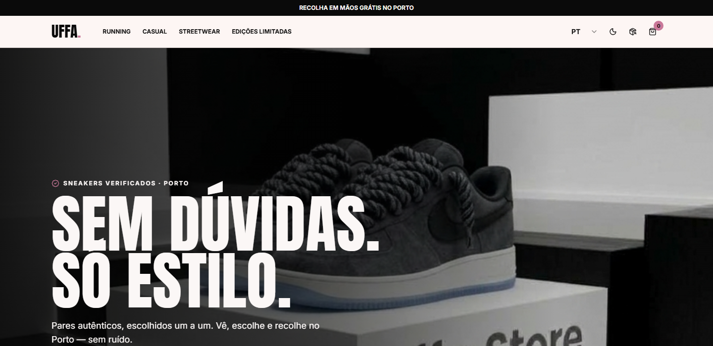

<a id="cap-02-1"></a>

### 2.1 Cabeçalho e navegação

O cabeçalho é fixo (`sticky`) e acompanha todas as páginas.

- **Altura** — `h-20 md:h-24`, com logótipo proporcional.
- **Menu** — Casual, Streetwear, Edições Limitadas, Promoções e Ajuda, em `text-xs md:text-sm` com `gap-6`.
- **Sublinhado animado** — no item ativo e em `hover`: ameixa `#4A2B33` no tema claro e rosa UFFA `#E1A0B4` no escuro.
- **Categorias sincronizadas** — o clique abre `/catalogo` já filtrado; se o cliente já estiver no catálogo, o filtro muda de imediato.
- **Ações** — idioma PT/EN/ES, tema claro/escuro, favoritos com contador, rastreio e carrinho.

Abaixo de `lg`, o menu passa para um painel lateral com logótipo, assinatura, as quatro categorias e atalhos para favoritos, ajuda, rastreio e verificação. Fecha ao escolher uma opção.

<a id="cap-02-2"></a>

### 2.2 Hero e faixa de confiança

1. **Hero** — imagem de destaque, promessa e botão para o catálogo.
2. **Faixa de confiança** — autenticidade, recolha no Porto e envio.
3. **Barra de anúncio** — “Recolha em mãos grátis no Porto”, no topo de todas as páginas.


<a id="cap-02-3"></a>

### 2.3 Categorias e destaques

- **Categorias** — Casual, Streetwear, Edições Limitadas e Promoções. Cada cartão abre o catálogo com o filtro certo.
- **Mais procurados** — produtos em destaque com preço, tamanhos, selo Verificado, placa PROMO e botão de compra.
- **Estado vazio** — se não houver destaques, a secção desaparece sem deixar espaço morto.

<a id="cap-02-4"></a>

### 2.4 Bloco do portal e newsletter

- **Bloco do portal** — convite para acompanhar a encomenda em `/rastreio`, com argumento de privacidade.
- **Newsletter** — formulário de email no fim da home; a subscrição é enviada para `atendimento@uffastore.pt` com confirmação visual.

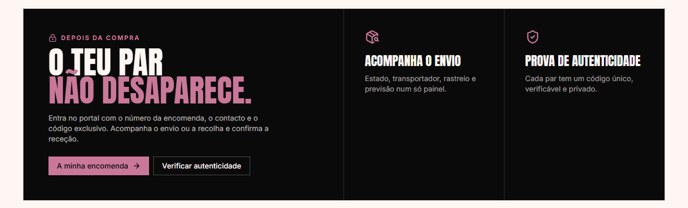

<a id="cap-02-5"></a>

### 2.5 Temas e idiomas

- Tema guardado em `localStorage` (`uffa-theme`).
- Idioma guardado no contexto da loja e mantido durante a sessão.
- Todos os textos de interface passam por `tr(language, pt, en, es)`.
- O modo escuro aplica-se a todo o site, incluindo checkout, portal e operações.

> **Dica.** Demonstrar o tema escuro no catálogo: é onde o contraste do preço e da placa PROMO se nota mais.

> **Checklist de demonstração.** Hero → faixa de confiança → categorias → destaque → bloco do portal. Alternar tema e idioma a meio.

---

<a id="cap-03"></a>

## 03 / CATÁLOGO

### Encontrar o par certo.

Catálogo com filtros combináveis, pesquisa instantânea e cartões que respondem antes do clique.

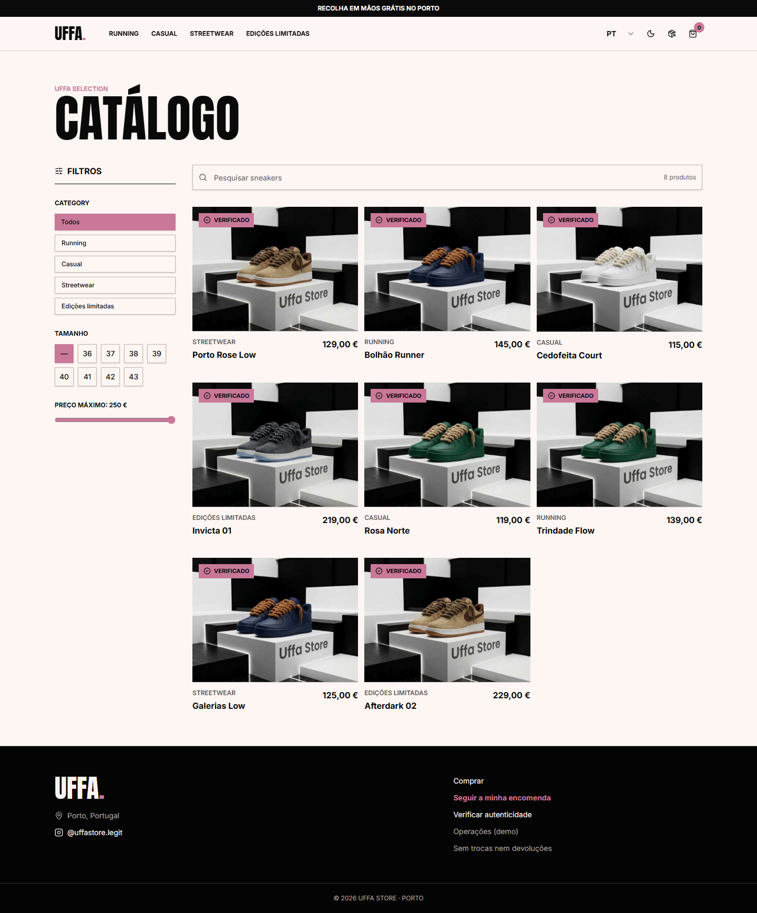

<a id="cap-03-1"></a>

### 3.1 Filtros e pesquisa

| Filtro | Comportamento |
| --- | --- |
| Categoria | Todas, Casual, Streetwear, Edições Limitadas e Promoções |
| Tamanho | 36 a 43, ou todos |
| Preço máximo | Controlo deslizante sobre o preço atual |
| Pesquisa | Filtra por nome em tempo real, sem recarregar |

- Os filtros combinam entre si e o resultado atualiza no momento.
- O botão de limpar devolve o catálogo completo.
- O estado vazio explica o que fazer e sugere remover filtros.

<a id="cap-03-2"></a>

### 3.2 Sincronização com o cabeçalho

O filtro de categoria vive no URL (`/catalogo?category=sales`), o que permite:

- partilhar um catálogo já filtrado;
- voltar atrás no browser e recuperar o filtro;
- clicar numa categoria do cabeçalho **mesmo estando no catálogo** e ver a grelha mudar sem recarregar.

Categorias suportadas: `casual`, `streetwear`, `limited`, `sales`.

> **Nota.** A categoria é derivada de `search.category` com fallback para `all`; a navegação usa `navigate({ search })`, pelo que o URL e o ecrã nunca divergem.

<a id="cap-03-3"></a>

### 3.3 Cartões de produto

Cada cartão mostra:

- imagem do par;
- selo **Verificado**;
- placa **PROMO** quando aplicável;
- nome e categoria;
- preço normal ou de oferta;
- tamanhos disponíveis;
- botão **Adicionar ao carrinho**;
- coração de favoritos.

Produtos sem stock aparecem como **ESGOTADO**, com o botão desativado.

<a id="cap-03-4"></a>

### 3.4 Preços e PROMO

- Preço normal e preço de oferta usam `font-bold text-foreground`.
- O preço de oferta fica **um nível de tamanho acima** do preço normal.
- O preço original aparece riscado, sem sombras.
- A placa **PROMO** usa a cor burgundy `--promo`, `border-2 border-promo`, preenchimento e tracking generosos, com contorno nítido em claro e escuro.

> **Dica.** Ao apresentar, comparar um cartão em promoção com um cartão a preço normal: a diferença é de hierarquia, não de peso tipográfico.

<a id="cap-03-5"></a>

### 3.5 Stock e estados

- **5 pares por tamanho** em todos os produtos do catálogo local.
- Tamanhos esgotados aparecem desativados na página de produto.
- Estado calculado automaticamente: sem stock em todos os tamanhos → **ESGOTADO**; caso contrário → **ATIVO**.

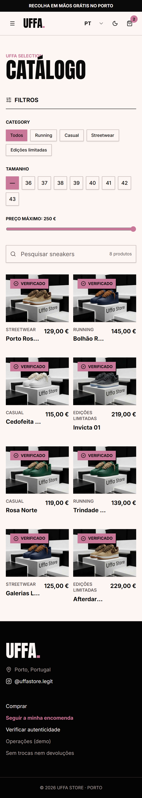

> **Checklist de demonstração.** Filtrar por Promoções no cabeçalho, mudar para Streetwear sem sair da página, pesquisar um nome e limpar tudo.

---

<a id="cap-04"></a>

## 04 / PRODUTO

### A decisão acontece aqui.

A página de produto responde às dúvidas todas antes do carrinho.

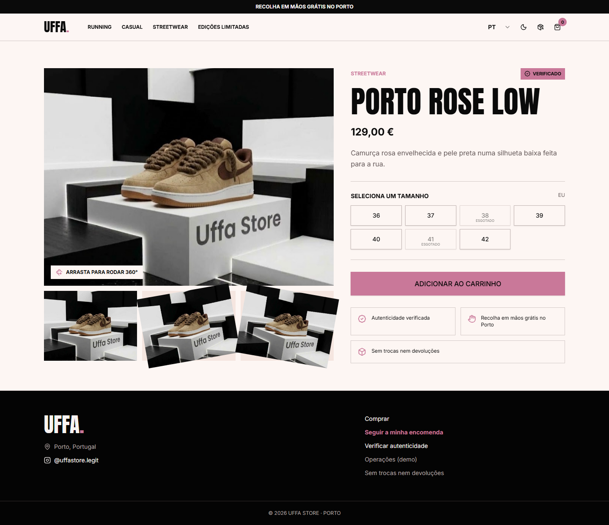

<a id="cap-04-1"></a>

### 4.1 Galeria e informação

- **Galeria** — imagem principal, miniaturas e rotação 360°.
- **Categoria e selo** — PROMO, ESGOTADO ou EM BREVE.
- **Nome e descrição** — traduzidos em PT/EN/ES.
- **Preço** — normal ou de oferta, com o original riscado.
- **Quantidade** — ajuste antes de adicionar.
- **Adicionar ao carrinho** — valida o tamanho escolhido.
- **Favoritos** — guarda o par na lista de desejos.

<a id="cap-04-2"></a>

### 4.2 Tamanhos e stock

- Só os tamanhos com stock ficam selecionáveis.
- Cada tamanho tem SKU e variante Shopify associados.
- O stock local está a **5 pares por tamanho**.
- Ao esgotar, o tamanho passa a desativado e o produto muda de estado quando todos acabam.

<a id="cap-04-3"></a>

### 4.3 Garantias e relacionados

- **Autenticidade** — cada par tem código `UFFA-AUTH`.
- **Recolha grátis no Porto** — visível sem abrir menus.
- **Política de trocas** — resumida junto ao preço.
- **Relacionados** — sugestões da mesma categoria, com o mesmo cartão do catálogo.

> **Nota.** O stock mostrado na demo é local (`src/lib/shop-data.ts`). Com a Storefront API configurada, o catálogo e a disponibilidade passam a vir da Shopify, com fallback automático para os dados locais.

> **Checklist de demonstração.** Escolher tamanho, mostrar um tamanho esgotado, adicionar ao carrinho e abrir os relacionados.

---

<a id="cap-05"></a>

## 05 / CARRINHO

### O último empurrão.

O carrinho é uma camada lateral: o cliente não perde o contexto da loja.

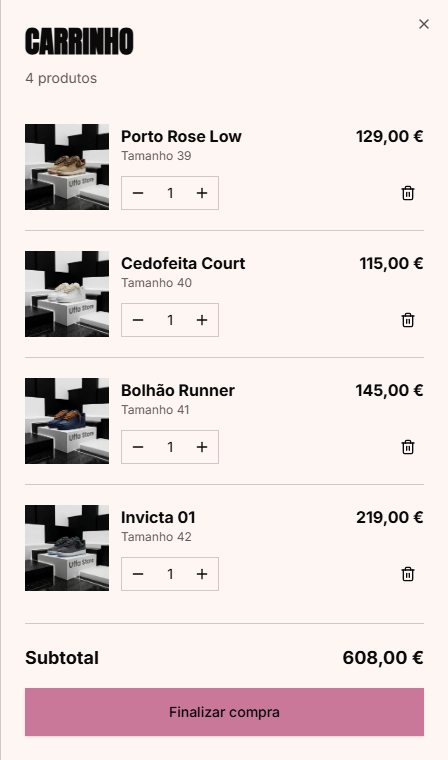

<a id="cap-05-1"></a>

### 5.1 Artigos, quantidades e confirmação

- Lista com imagem, nome, tamanho, quantidade e preço.
- **Confirmação via toast** ao adicionar itens, com ação não intrusiva "Ver carrinho" — sem redirecionamentos automáticos.
- Alteração de quantidade com `+` / `-`.
- Remoção individual.
- Subtotal, desconto e total sempre visíveis.
- **Finalizar encomenda** leva ao checkout.

<a id="cap-05-2"></a>

### 5.2 Cupões

| Código | Desconto |
| --- | --- |
| `UFFA10` | 10% |
| `PORTO20` | 20% |
| `VIP15` | 15% |

O código é validado localmente, sem distinção de maiúsculas, e aplicado ao subtotal. Um código inválido devolve mensagem clara e não altera o total.

<a id="cap-05-3"></a>

### 5.3 Partilha e persistência

- **Partilhar no WhatsApp** — gera mensagem com o resumo do carrinho.
- **Copiar carrinho** — copia o resumo para a área de transferência.
- O carrinho persiste em `localStorage` (`uffa-cart`) e sobrevive a recargas.

> **Dica.** Aplicar `PORTO20` durante a demo: o desconto aparece no resumo e segue para a Shopify como `discountCodes`.

> **Checklist de demonstração.** Adicionar dois pares, mudar quantidades, aplicar cupão, copiar resumo e avançar para o checkout.

---

<a id="cap-06"></a>

## 06 / CHECKOUT

### Três decisões. Zero fricção.

Entrega, pagamento e confirmação — sem criação de conta.

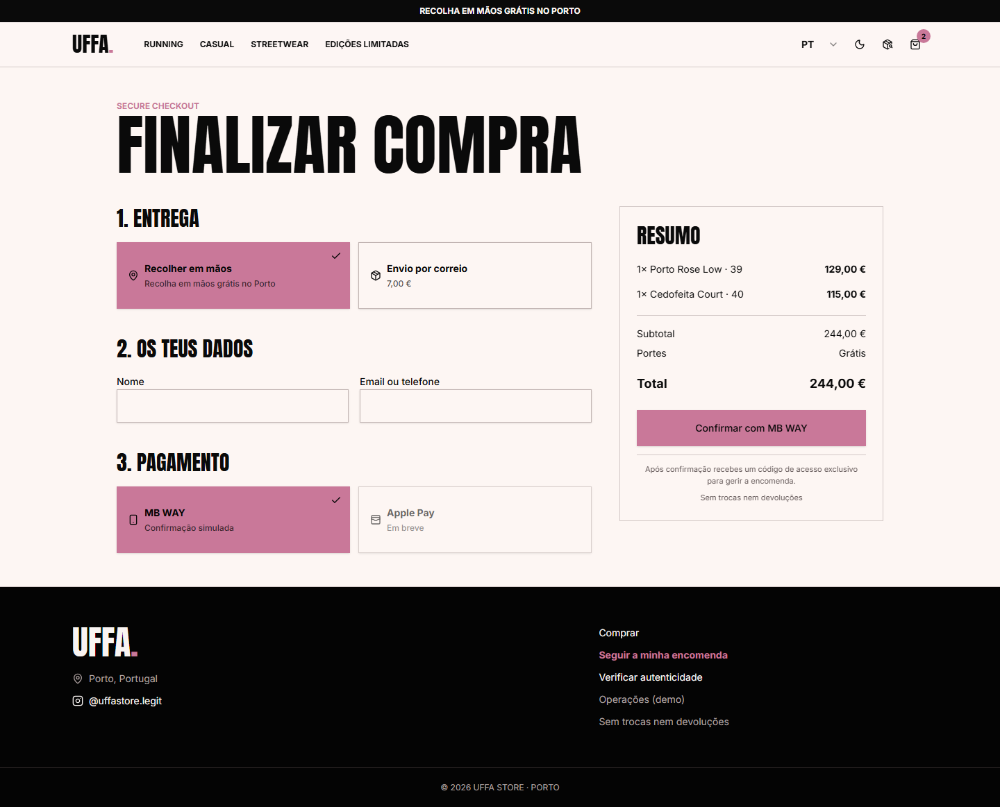

<a id="cap-06-1"></a>

### 6.1 Entrega e portes

| Opção | Preço | Nota |
| --- | --- | --- |
| Recolha em mão no Porto | **0,00 €** | Entrega combinada com a equipa |
| Portugal Continental | **8,94 €** | Envio expresso |
| Portugal — Ilhas | **8,94 €** | Açores e Madeira |
| União Europeia | **24,00 €** | Qualquer país da UE |
| Suíça | **34,00 €** | Envio internacional |

O resumo atualiza o total assim que a modalidade muda.

<a id="cap-06-2"></a>

### 6.2 Pagamento e Shopify

- O checkout local apresenta **Cartão / MB WAY / Google Pay** como método seguro via Shopify.
- Ao clicar em **Pagar agora**, o cliente é redirecionado para o checkout oficial da Shopify.
- Aí completa nome, email, telefone e morada, e escolhe o método disponível na loja.
- Não é criada conta UFFA.

A integração cria um checkout com:

- variantes e quantidades;
- modalidade de entrega e respetivo custo, via atributos `Modalidade de Entrega`, `Portes de Envio`, `Tipo de Envio` e `Destino / Zona`;
- código de desconto, quando aplicável;
- idioma do cliente.

<a id="cap-06-3"></a>

### 6.3 Cupões e erros

- O desconto é aplicado ao subtotal e passado como `discountCodes`.
- Sem variáveis Shopify válidas, o catálogo local continua a funcionar, mas o checkout não conclui — mostrar a mensagem de erro e validar o `.env`.

> **Atenção.** O checkout é o único ponto que sai do domínio. Ensaie a demo com a loja Shopify em ambiente de testes para não gerar encomendas reais.

> **Checklist de demonstração.** Comparar recolha e envio, mostrar o total a mudar, explicar o salto para a Shopify e voltar atrás.

---

<a id="cap-07"></a>

## 07 / CONFIRMAÇÃO

### O pós-compra começa aqui.

A confirmação explica o que guardar e o que fazer a seguir.

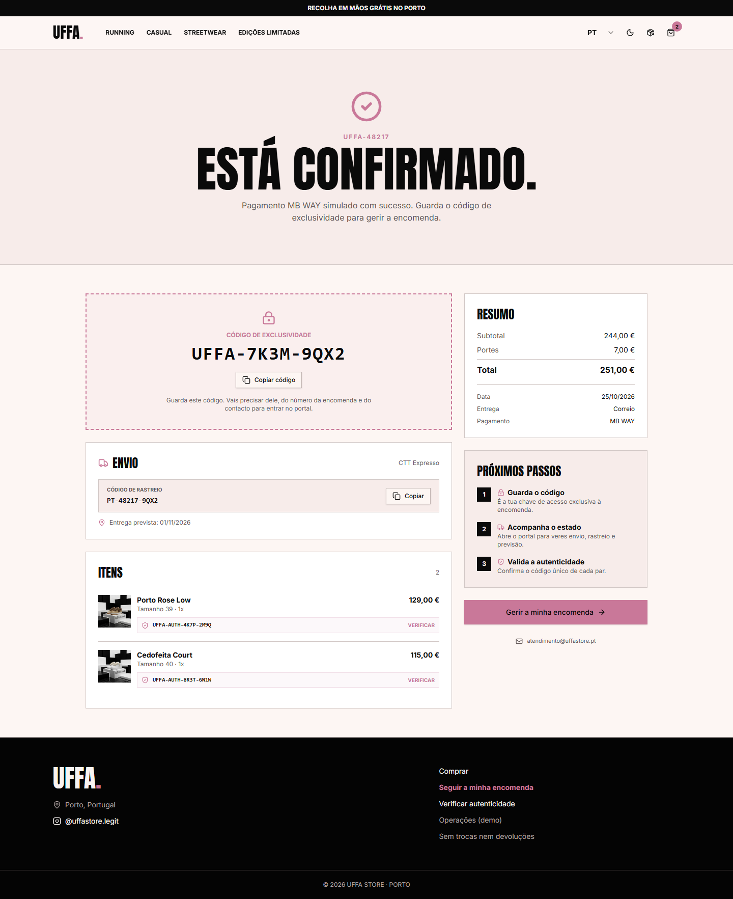

<a id="cap-07-1"></a>

### 7.1 O que o cliente recebe

- **Número da encomenda** — `UFFA-XXXXX`.
- **Código exclusivo** — `UFFA-XXXX-XXXX`, a chave do portal.
- **Código de rastreio** — nas encomendas com envio.
- **Código de autenticidade por par** — `UFFA-AUTH-XXXX-XXXX`.
- **Resumo** — artigos, entrega, subtotal, portes e total.
- **Próximos passos** — guardar o código e acompanhar em `/rastreio`.

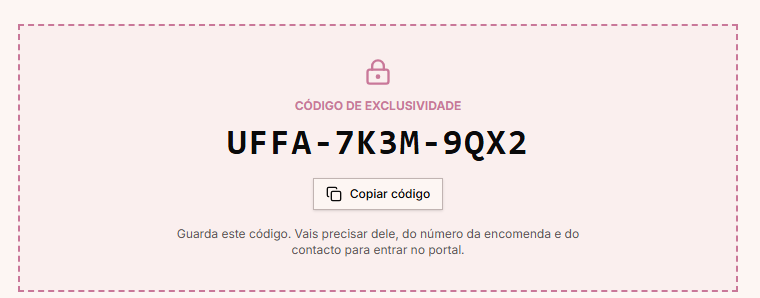

<a id="cap-07-2"></a>

### 7.2 Âmbito da demonstração

- A página lê as encomendas guardadas no browser (`uffa-orders-v1`).
- Nas encomendas concluídas na Shopify, a confirmação e o acompanhamento são enviados pela própria Shopify por email.
- A confirmação local só encontra uma encomenda se ela existir nesse armazenamento.

> **Nota.** Este é o ponto onde a demo e a produção mais divergem. Diga-o em voz alta: evita expectativas erradas sobre sincronização automática.

> **Checklist de demonstração.** Abrir `/confirmacao?order=UFFA-48217`, copiar o código e entrar no portal com ele.

---

<a id="cap-08"></a>

## 08 / PORTAL

### O par não desaparece.

O cliente passa a ter um espaço privado para acompanhar envio ou recolha e confirmar a entrega.

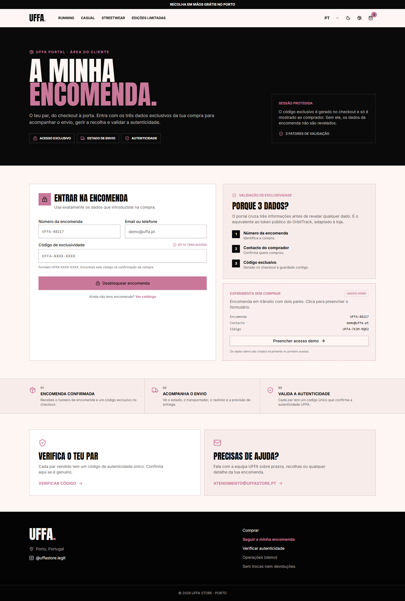

<a id="cap-08-1"></a>

### 8.1 Acesso por três fatores

| Fator | Exemplo |
| --- | --- |
| Número da encomenda | `UFFA-48217` ou apenas `48217` |
| Contacto | `demo@uffa.pt` |
| Código exclusivo | `UFFA-7K3M-9QX2` |

Regras de proteção:

- **5 tentativas** falhadas por encomenda;
- **bloqueio de 60 segundos** ao atingir o limite;
- **sessão de 30 minutos**;
- botão **Terminar sessão** sempre visível.

<a id="cap-08-2"></a>

### 8.2 Dashboard do cliente

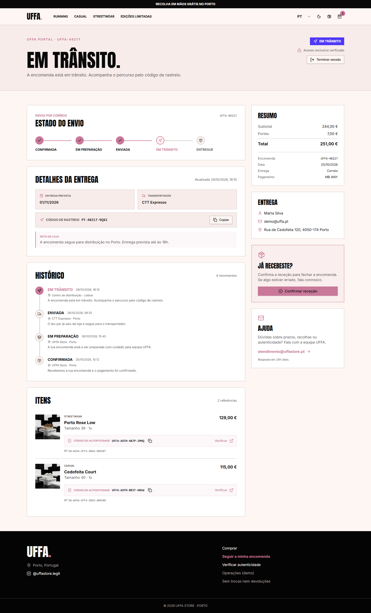

- Estado atual e linha temporal.
- Previsão de entrega ou data limite de recolha.
- Transportador e código de rastreio, no envio.
- Morada da loja e nota pública, na recolha.
- Resumo de valores.
- Itens com código de autenticidade.
- Botão **Confirmar receção** ou **Confirmar recolha**.

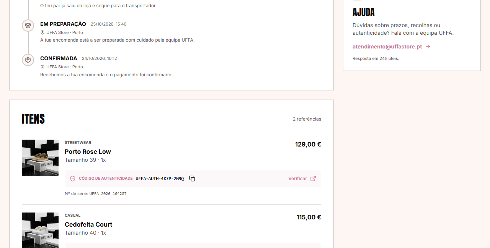

<a id="cap-08-3"></a>

### 8.3 Fluxos de estado

**Envio**

```text
Confirmada → Em preparação → Enviada → Em trânsito → Entregue
```

**Recolha**

```text
Confirmada → Em preparação → Pronta para recolha → Recolhida
```

**Independente:** `Cancelada`

Cada mudança cria um evento com data e hora no histórico visível ao cliente.

> **Dica.** A nota pública é o único campo escrito à mão que o cliente vê. Use-a para dar contexto (“O teu par está reservado ao balcão”), não para dados internos.

> **Checklist de demonstração.** Entrar com as credenciais demo, mostrar a timeline, confirmar a receção e terminar sessão.

---

<a id="cap-09"></a>

## 09 / AUTENTICIDADE

### A prova de autenticidade.

Cada par tem um código único. Qualquer pessoa pode validá-lo, sem ver dados do comprador.

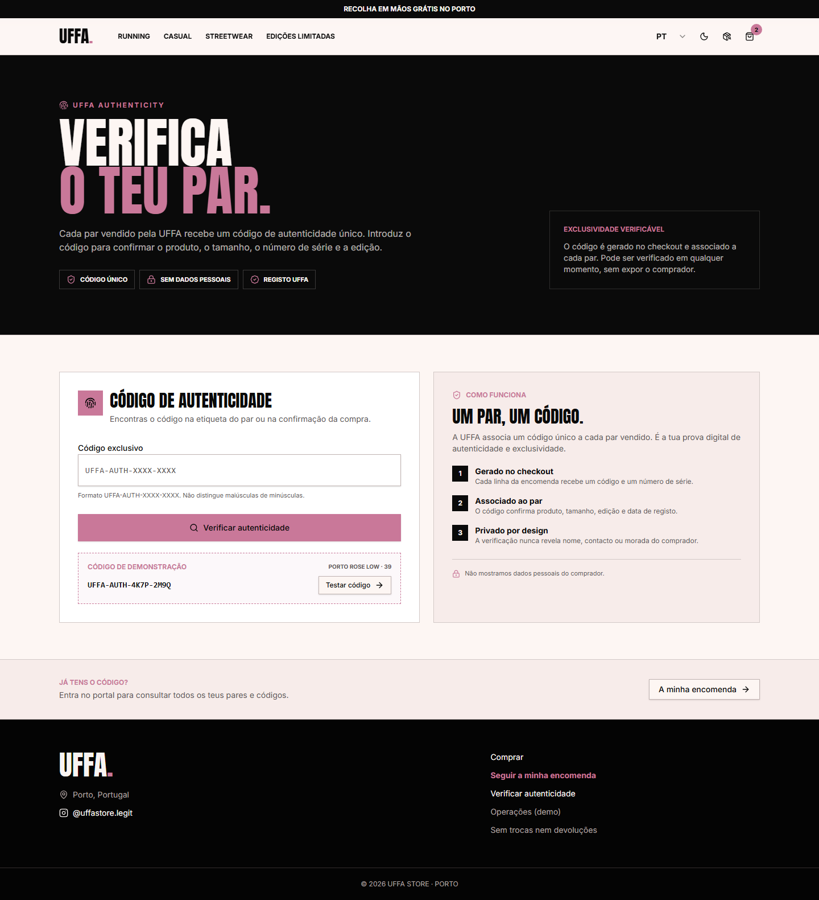

<a id="cap-09-1"></a>

### 9.1 Como verificar

1. Abrir `/verificar`.
2. Introduzir o código `UFFA-AUTH-XXXX-XXXX`.
3. Confirmar o resultado.

Também aceita link direto: `/verificar?codigo=UFFA-AUTH-XXXX-XXXX`. O código não distingue maiúsculas de minúsculas.

<a id="cap-09-2"></a>

### 9.2 Resultado válido

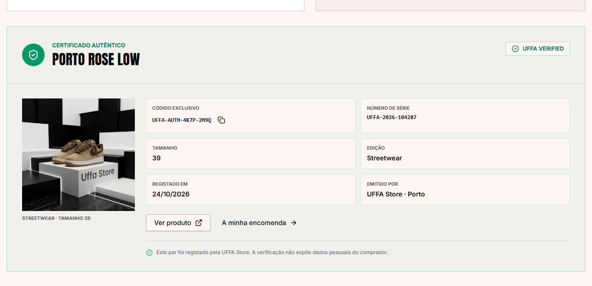

O certificado mostra:

- selo **UFFA Verified**;
- produto e tamanho;
- edição e número de série;
- data de emissão;
- loja emissora.

<a id="cap-09-3"></a>

### 9.3 Resultado inválido e privacidade

- Código inexistente devolve mensagem clara e contacto da equipa.
- O resultado **nunca** mostra nome, email, telefone ou morada do comprador.
- O código é a única chave: quem o tiver consegue validar, mas não acede à encomenda.

> **Nota.** Autenticidade e portal são sistemas separados de propósito. Validar um par não dá acesso a dados pessoais.

> **Checklist de demonstração.** Validar `UFFA-AUTH-4K7P-2M9Q`, mostrar o certificado e depois um código inválido.

---

<a id="cap-10"></a>

## 10 / OPERAÇÕES

### Gerir sem folhas de cálculo.

Painel interno de demonstração para atualizar estado, previsão, rastreio, transportador e nota pública.

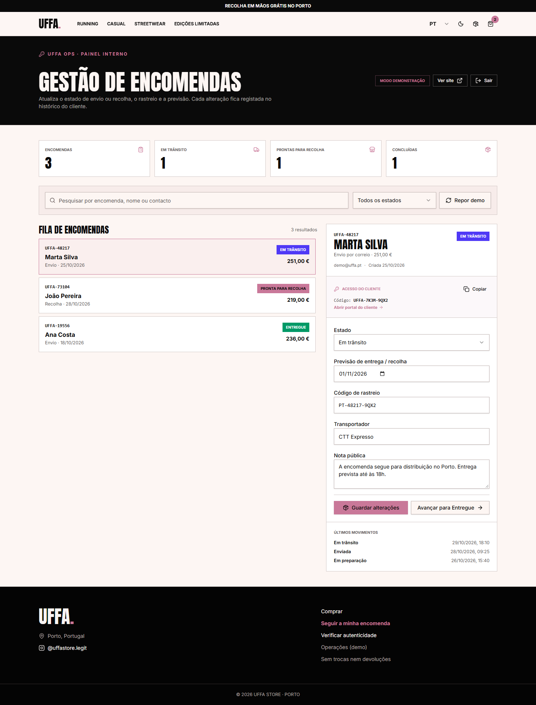

<a id="cap-10-1"></a>

### 10.1 Entrada e indicadores

- **Chave demo:** `UFFA-OPS-2026`.
- Indicadores: total, em trânsito, prontas para recolha e concluídas.
- Sessão terminada pelo botão **Sair**.

<a id="cap-10-2"></a>

### 10.2 Fila e pesquisa

- Pesquisa por número, nome ou contacto.
- Filtro por estado.
- Fila ordenada pela última atualização.
- Cada linha mostra número, cliente, estado e entrega.

<a id="cap-10-3"></a>

### 10.3 Editor e avanço de estado

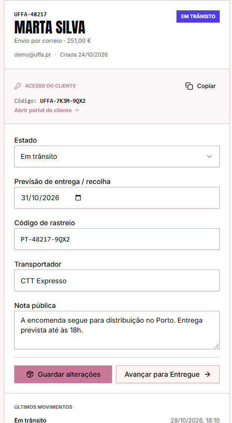

- Estado, previsão, rastreio, transportador e nota pública.
- **Avançar para…** move para o estado seguinte permitido.
- O editor adapta-se ao tipo de entrega: rastreio e transportador só aparecem em envios.
- Cada gravação cria um evento no histórico.

<a id="cap-10-4"></a>

### 10.4 Credenciais, histórico e reposição

- **Copiar** gera credenciais e link do portal para enviar ao cliente.
- **Histórico** lista os últimos movimentos.
- **Repor demo** restaura as encomendas de exemplo.
- As alterações refletem-se de imediato no portal do cliente.

> **Atenção.** O painel é uma demonstração local. Em produção exige autenticação real, registo de auditoria e persistência no servidor.

> **Checklist de demonstração.** Entrar, filtrar “Em trânsito”, avançar `UFFA-48217`, copiar credenciais e mostrar o portal atualizado.

---

<a id="cap-11"></a>

## 11 / MOBILE

### A mesma experiência, no bolso.

Layout mobile-first, validado a 390 px, sem funcionalidades escondidas.

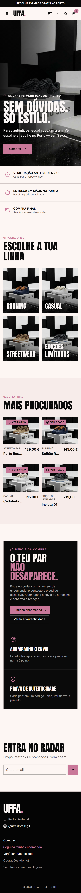

<a id="cap-11-1"></a>

### 11.1 Breakpoints e menu

- Abaixo de `lg`, o menu passa para painel lateral com categorias e atalhos.
- O cabeçalho reduz para `h-20`, mantendo o logótipo proporcional.
- A barra de anúncio continua visível.

<a id="cap-11-2"></a>

### 11.2 Ecrãs pequenos


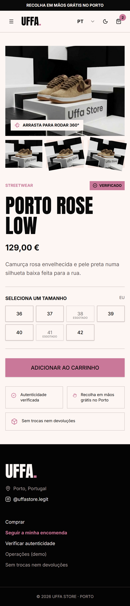

- Grelha do catálogo empilhada; filtros utilizáveis.
- Produto com galeria, tamanhos e CTA ao alcance do polegar.
- Carrinho e checkout a largura total.
- Portal e operações com cartões empilhados.
- Alvos de toque com pelo menos 44 px.
- Imagens com `alt` e carregamento diferido.

> **Dica.** Demonstrar sempre o mesmo fluxo em mobile e desktop: a narrativa mantém-se, o layout adapta-se.

> **Checklist de demonstração.** Abrir o menu lateral, filtrar o catálogo, escolher tamanho e chegar ao checkout.

---

<a id="cap-12"></a>

## 12 / TECNOLOGIA

### Simples na demo, pronto para produção.

Stack moderna, dados isolados por camada e fallback automático.

<a id="cap-12-1"></a>

### 12.1 Stack e ficheiros

| Camada | Tecnologia |
| --- | --- |
| Interface | React 19 + TanStack Start |
| Estilo | Tailwind CSS + tokens de tema |
| Dados | `src/lib/shop-data.ts` (local) e Storefront API |
| Encomendas | `src/lib/orders.ts` + `localStorage` |
| Build | Vite + Nitro (preset Cloudflare) |
| Deploy | Vercel, automático em `main` |

| Ficheiro | Responsabilidade |
| --- | --- |
| `src/lib/shop-data.ts` | Produtos, preços, tamanhos, stock e textos |
| `src/lib/shopify.ts` | Catálogo e checkout Shopify |
| `src/lib/orders.ts` | Encomendas, códigos, estados e sessões |
| `src/lib/shop-context.tsx` | Carrinho, favoritos, cupões, tema e idioma |
| `src/components/site-shell.tsx` | Cabeçalho, navegação, carrinho e footer |
| `src/routes/*` | Uma rota por ecrã |
| `docs/shopify/produtos-uffa.csv` | Catálogo de importação com 5 unidades por variante |

<a id="cap-12-2"></a>

### 12.2 Variáveis de ambiente

| Variável | Onde encontrar |
| --- | --- |
| `VITE_SHOPIFY_STORE_DOMAIN` | `xxxxx.myshopify.com` |
| `VITE_SHOPIFY_STOREFRONT_ACCESS_TOKEN` | Admin → Headless → Storefront API → token público |

Sem estas variáveis, o site usa o catálogo local e o checkout Shopify não conclui.

<a id="cap-12-3"></a>

### 12.3 Build, deploy e segurança

```bash
npm install
npm run dev        # http://localhost:8080
npx tsc --noEmit
npm run build
```

- O deploy de produção é automático na Vercel a cada push para `main`.
- A demonstração guarda encomendas, tentativas e sessões no browser.
- Em produção, validação e persistência têm de passar para um backend com autenticação, base de dados e auditoria.

> **Atenção.** Nunca colocar o token de admin da Shopify no cliente. A Storefront API usa apenas o token público.

> **Checklist de demonstração.** Mostrar o `.env.example`, explicar o fallback e terminar no build a passar.

---

<a id="ap-a"></a>

## ANEXO A — DADOS DE DEMONSTRAÇÃO

### Encomendas

| Encomenda | Contacto | Código exclusivo | Estado |
| --- | --- | --- | --- |
| `UFFA-48217` | `demo@uffa.pt` | `UFFA-7K3M-9QX2` | Em trânsito |
| `UFFA-73104` | `demo@uffa.pt` | `UFFA-2P8N-5RV6` | Pronta para recolha |

### Códigos de autenticidade

| Código | Produto | Tamanho |
| --- | --- | --- |
| `UFFA-AUTH-4K7P-2M9Q` | Porto Rose Low | 39 |
| `UFFA-AUTH-8R3T-6N1W` | Cedofeita Court | 40 |
| `UFFA-AUTH-9C2L-7B4X` | Invicta 01 | 42 |

### Cupões

| Código | Desconto |
| --- | --- |
| `UFFA10` | 10% |
| `PORTO20` | 20% |
| `VIP15` | 15% |

### Acessos

| Sistema | Credencial |
| --- | --- |
| Painel de operações | `UFFA-OPS-2026` |
| Portal do cliente | Número + contacto + código exclusivo |
| Verificação | Código `UFFA-AUTH-XXXX-XXXX` |

> **Nota.** `Repor demo` em `/operacoes` recria as encomendas de exemplo e apaga alterações locais.

---

<a id="ap-b"></a>

## ANEXO B — RESOLUÇÃO DE PROBLEMAS

| Sintoma | Causa provável | Solução |
| --- | --- | --- |
| O site mostra o catálogo local | Variáveis Shopify em falta | Preencher `.env` e reiniciar o servidor |
| Produto não aparece | Estado `inactive` ou sem stock | Verificar `status` e `stock` em `shop-data.ts` |
| Categoria não filtra | URL sem `?category=` | Clicar na categoria do menu ou abrir `/catalogo?category=casual` |
| Filtro não muda no catálogo | Estado antigo em cache | Recarregar; confirmar `search.category` no URL |
| Checkout não abre na Shopify | Domínio ou token inválidos | Validar variáveis e a consola do browser |
| Portal recusa acesso | Dados ou código incorretos | Usar as credenciais do Anexo A ou repor demo |
| Portal bloqueado | 5 tentativas falhadas | Aguardar 60 segundos |
| Sessão expirou | Passaram 30 minutos | Voltar a entrar |
| Tema não guarda | `localStorage` bloqueado | Permitir armazenamento no browser |
| Confirmação vazia | Encomenda não existe localmente | Usar uma encomenda demo do Anexo A |
| Preço de oferta sem destaque | Falta de `originalPrice` | Confirmar o campo no produto |
| Imagem não carrega | Caminho ou asset em falta | Validar `src/assets` e o `alt` |

---

<a id="ap-c"></a>

## ANEXO C — COMANDOS, BUILD E DEPLOY

```bash
# instalar
npm install

# desenvolvimento
npm run dev            # http://localhost:8080

# validação
npx tsc --noEmit
npm run build
npm run lint

# apresentações
npm install --no-save --package-lock=false pptxgenjs
node scripts/build-apresentacao-site.mjs
node scripts/build-apresentacao.mjs

# manual em HTML
node scripts/build-manual.mjs

# publicar
git add .
git commit -m "docs: atualizar manual e materiais"
git push origin main
```

| Comando | Efeito |
| --- | --- |
| `npm run dev` | Servidor local com hot reload |
| `npx tsc --noEmit` | Verificação de tipos |
| `npm run build` | Build de produção |
| `node scripts/build-manual.mjs` | Gera `docs/manual-site.html` |
| `node scripts/build-apresentacao-site.mjs` | Gera o deck do site |

---

<a id="ap-d"></a>

## ANEXO D — MAPA DE FICHEIROS E GLOSSÁRIO

### Documentação

| Ficheiro | Conteúdo |
| --- | --- |
| `docs/manual-site.md` | Este manual (fonte) |
| `docs/manual-site.html` | Manual paginado no estilo da apresentação |
| `docs/guia-apresentacao-site.md` | Guião slide a slide do site |
| `docs/guia-apresentacao.md` | Guião slide a slide do portal |
| `docs/portal-encomendas.md` | Arquitetura e segurança do portal |
| `docs/apresentacao-site-uffa.pptx` | Apresentação do site |
| `docs/apresentacao-uffa.pptx` | Apresentação do portal |
| `docs/assets/screenshots/` | Capturas completas e recortes |

### Glossário

| Termo | Significado |
| --- | --- |
| **Código exclusivo** | Chave `UFFA-XXXX-XXXX` que dá acesso ao portal |
| **Código de autenticidade** | `UFFA-AUTH-XXXX-XXXX`, prova pública por par |
| **PROMO** | Placa burgundy que marca preço de oferta |
| **Verificado** | Selo de autenticidade no cartão e no produto |
| **Storefront API** | API pública da Shopify usada pelo catálogo |
| **Fallback local** | Catálogo de `shop-data.ts` usado se a API falhar |
| **Repor demo** | Restaura as encomendas de exemplo |
| **Sessão protegida** | Acesso ao portal válido por 30 minutos |

---

**UFFA Store** · Porto · `atendimento@uffastore.pt` · [@uffastore.legit](https://www.instagram.com/uffastore.legit/)

[Voltar ao índice](#indice)
